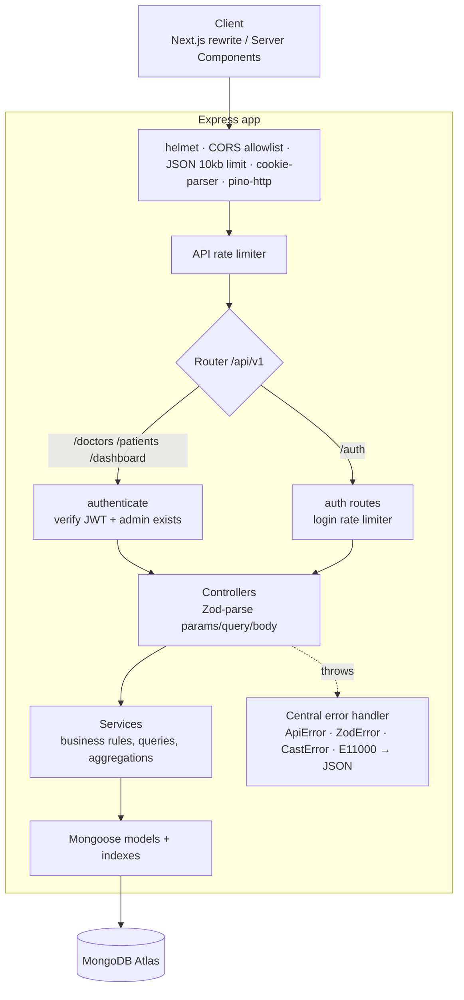
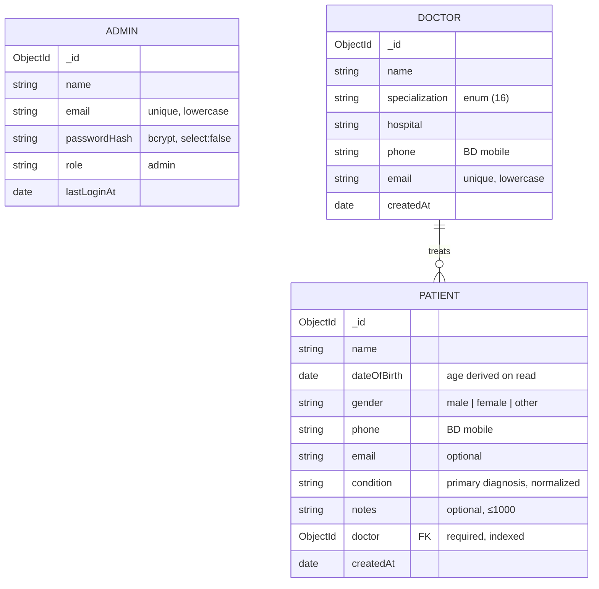

# Doctor Tracker — API

> RESTful backend for Doctor Tracker: secure admin authentication, doctor & patient management, and aggregation-based care analytics.
> **Backend repository** · Frontend: [doctor-tracker-web](https://github.com/anikcse19/doctor-tracker-web)

| | |
|---|---|
| **Live API** | https://doctor-tracker-api-54fy.onrender.com/api/v1/health |
| **Live app** | https://doctor-tracker-web-phi.vercel.app |
| **Demo login** | `admin@doctortracker.app` / `CareGuide@2026` |

> Hosted on Render's free tier — the service sleeps after 15 minutes idle, so the first request may take ~50 s.


---

## Elevator pitch

Doctor Tracker gives a healthcare administrator one clear view of their care network. This API powers it: admins authenticate with an HttpOnly-cookie session, manage doctors and the patients assigned to them, and search, filter and paginate both collections. A single dashboard endpoint turns the raw records into analytics — registration trends, workload per doctor, specialty coverage, condition mix and demographics — using MongoDB aggregation pipelines over real data, with indexes shaped to every query.

---

## Contents

1. [Tech stack](#tech-stack) · 2. [Setup guide](#setup-guide) · 3. [System architecture](#system-architecture) · 4. [Technical decisions](#technical-decisions) · 5. [API reference](#api-reference) · 6. [Database schema](#database-schema) · 7. [Security](#security) · 8. [Performance](#performance) · 9. [Visual evidence](#visual-evidence) · 10. [Testing](#testing)

---

## Tech stack

| Concern | Choice | Why |
|---|---|---|
| Runtime / framework | **Node.js + Express 5**, TypeScript (ESM) | Express 5 forwards rejected promises to the error handler natively — no `asyncHandler` wrappers |
| Database | **MongoDB Atlas + Mongoose 9** | Schemas, validation, indexes, aggregation |
| Validation | **Zod 4** | One schema = runtime validation + static types; also validates env vars at boot |
| Auth | **jsonwebtoken (HS256) + bcryptjs (cost 12)** + cookie-parser | Pure-JS bcrypt → no native build issues on Windows/Render |
| Hardening | **helmet, cors, express-rate-limit** | Security headers, origin allowlist, brute-force protection |
| Logging | **pino / pino-http** | Structured logs with cookies & auth headers redacted |
| Tooling | tsx, ESLint (typescript-eslint), Prettier, @faker-js/faker (seed only) | |

---

## Setup guide

### Prerequisites
- Node.js **≥ 20.19** (developed on 24) and npm
- A MongoDB database (free Atlas **M0** cluster is enough)

### Install & run

```bash
git clone https://github.com/anikcse19/doctor-tracker-api.git
cd doctor-tracker-api
npm install
cp .env.example .env     # fill in the values below
npm run seed             # demo admin + 42 doctors + 640 patients (6 months of history)
npm run dev              # → http://localhost:4000/api/v1/health
```

### Environment variables

| Variable | Required | Default | Description |
|---|---|---|---|
| `MONGODB_URI` | ✅ | — | Atlas/local connection string |
| `MONGODB_DB_NAME` | | `doctor-tracker` | Explicit DB name (data never lands in the driver's default `test` DB) |
| `JWT_SECRET` | ✅ | — | ≥ 32 chars. `node -e "console.log(require('crypto').randomBytes(48).toString('hex'))"` |
| `JWT_EXPIRES_IN` | | `8h` | Session lifetime (`15m`, `8h`, `7d`…) |
| `CORS_ORIGINS` | | `http://localhost:3000` | Comma-separated allowed origins (the frontend URL) |
| `TRUST_PROXY_HOPS` | | `1` | Reverse proxies in front of the API — `2` in production (Vercel rewrite → Render) |
| `PORT` | | `4000` | |
| `SEED_ADMIN_EMAIL` / `SEED_ADMIN_PASSWORD` | seed only | — | Demo admin created/reset by `npm run seed` |
| `DNS_SERVERS` | | — | Local-dev escape hatch for `querySrv ECONNREFUSED` (e.g. `8.8.8.8,1.1.1.1`) |

The app **refuses to start** with a readable error if any required variable is missing or malformed (`src/config/env.ts`).

### Database setup
1. Create an Atlas cluster → **Database Access**: add a user with read/write → **Network Access**: allow your IP (or `0.0.0.0/0` for Render, which has no static egress IP).
2. Put the connection string in `MONGODB_URI`.
3. `npm run seed` — creates indexes (`syncIndexes`), upserts the admin and loads deterministic demo data. Re-run any time to reset the demo.

### Scripts

| Command | |
|---|---|
| `npm run dev` | Watch mode via tsx |
| `npm run build` / `npm start` | Compile to `dist/` / run compiled server |
| `npm run seed` | Reset demo data |
| `npm run typecheck` · `npm run lint` · `npm run format` | Quality gates |

### Demo account
`admin@doctortracker.app` / `CareGuide@2026`. There is no public registration endpoint by design — this is an internal admin tool; accounts are provisioned by the seed script.

---

## System architecture



**Layering** (per feature module in `src/modules/{auth,doctors,patients,dashboard}`):

| Layer | Responsibility |
|---|---|
| `*.routes.ts` | URL → controller mapping; middleware order (static routes before `/:id`) |
| `*.controller.ts` | HTTP only: parse & validate with Zod, call service, shape response |
| `*.service.ts` | Business logic and all database access |
| `*.model.ts` | Schema, constraints, indexes |
| `*.schema.ts` | Zod request schemas (bodies are `.strict()` — unknown fields rejected) |

**Request lifecycle:** security middleware → rate limit → `authenticate` (cookie or `Bearer`) → controller validates → service queries → `sendSuccess` envelope. Any thrown error goes to one handler that converts known errors into client-safe responses and logs unknown ones without leaking details.

**Response envelope**

```jsonc
// success (list)
{ "success": true, "data": [ ... ], "meta": { "page": 1, "limit": 10, "total": 42, "totalPages": 5, "hasNextPage": true, "hasPrevPage": false } }
// error
{ "success": false, "error": { "code": "VALIDATION_ERROR", "message": "Validation failed", "details": [ { "field": "phone", "message": "Enter a valid Bangladeshi mobile number (01XXXXXXXXX)" } ] } }
```

---

## Technical decisions

### 1. Pagination & indexing strategy

**Offset pagination, done carefully.** List endpoints accept `page` and `limit` (1–100). The page query and `countDocuments` run **concurrently** (`Promise.all`), every sort ends with an `_id` tiebreaker so pages never overlap or skip records when timestamps tie, and the API reports `total`, `totalPages`, `hasNextPage`.

*Why offset and not cursor?* Admin tables need "page 4 of 9" and a total count; cursor (keyset) pagination can't jump to arbitrary pages and makes totals a separate cost anyway. Offset's weakness is deep `skip` — MongoDB still walks the skipped index entries — which only matters at tens of thousands of rows deep. The upgrade path is keyset pagination on `(createdAt, _id)` (the same indexes already support it) for infinite scroll or exports.

**Indexes are shaped like the queries** (equality → sort → tiebreaker):

| Collection | Index | Serves |
|---|---|---|
| doctors | `{ email: 1 }` unique | duplicate check (→ 409) |
| doctors | `{ createdAt: -1, _id: -1 }` | default sort + joined-date range |
| doctors | `{ specialization: 1, createdAt: -1, _id: -1 }` | specialization filter, newest first |
| doctors | `{ name: 1 }` · `{ hospital: 1 }` | A–Z sort, `/options` · hospital filter + `distinct` |
| patients | `{ doctor: 1, createdAt: -1, _id: -1 }` | a doctor's patient list, per-doctor counts (`$lookup`), dashboard grouping |
| patients | `{ condition: 1, createdAt: -1, _id: -1 }` | condition filter + `distinct('condition')` |
| patients | `{ createdAt: -1, _id: -1 }` | default sort, date range, trend aggregation |
| patients | `{ name: 1 }` | A–Z sort |

Verified with `explain('executionStats')` on the real data — the first version of the compound indexes lacked `_id`, which forced an in-memory `SORT` stage (16 docs examined to return 10). Adding the tiebreaker to the index fixed it:

| Query | Index used | Docs examined / returned | In-memory sort |
|---|---|---|---|
| doctor's patients, newest first | `doctor_1_createdAt_-1__id_-1` | 4 / 4 | no |
| patients by condition, newest first | `condition_1_createdAt_-1__id_-1` | 10 / 10 | no |
| doctors by specialization | `specialization_1_createdAt_-1__id_-1` | 2 / 2 | no |
| default patient page (skip 20) | `createdAt_-1__id_-1` | 10 / 10 | no |

**Search** uses an escaped, length-capped, case-insensitive regex across a few fields, applied together with indexed filters. `$text` was rejected because it can't match partial words ("joh" ≠ "John"); **Atlas Search** is the right tool at larger scale (autocomplete, fuzzy matching) and is the documented upgrade path.

### 2. No N+1: joins and analytics in the database

- **Doctor list with patient counts** — a single aggregation: `$match → $sort → $skip → $limit → $lookup(patients, pipeline: [$count])`. The join runs only for the ≤ 100 doctors on the current page (after `$limit`), and the lookup is an indexed equality on `patients.doctor`. Alternative considered: a denormalized `patientCount` on each doctor — faster reads at scale, but it needs transactional `$inc` on every create/delete/reassign to stay correct. For this workload, computing it is correct by construction.
- **Patient list with doctor names** — `populate('doctor', 'name specialization hospital')` resolves the whole page with **one `$in` query**, not one query per patient.
- **Dashboard** — one endpoint, eight independent queries run **in parallel**. The four patient breakdowns (top doctors, conditions, gender, age buckets) share **one `$facet` pass** instead of four collection scans; headline counts use `estimatedDocumentCount()` (collection metadata, O(1)); the registration trend groups by `$dateTrunc` in **Asia/Dhaka** time and the service fills empty days/weeks with zeros so the chart's time axis is honest. Age is computed from `dateOfBirth` at query time (we store DOB, not age, so it never goes stale).

### 3. Defense-in-depth validation

Every input is parsed by Zod before it reaches a service: `ObjectId` params are regex-checked (bad IDs → 422, not a `CastError` 500), bodies are `.strict()` (blocks mass assignment such as `createdAt` or `role`), strings are trimmed/normalized (`"  type 2 diabetes "` → `"Type 2 diabetes"` so filters and analytics don't fragment), phone numbers are validated against the Bangladeshi mobile format, `from ≤ to` is enforced for date ranges, and `limit` is capped. Behind that, `mongoose.set('sanitizeFilter', true)` neutralizes any `$`-operator that could still reach a query — server-built operators (like the date range) are explicitly marked with `mongoose.trusted()`.

---

## API reference

Base URL: `/api/v1` · All routes except `/health` and `/auth/login|logout` require authentication.

### Health & auth

| Method | Path | Description | Responses |
|---|---|---|---|
| GET | `/health` | Liveness + DB state (not rate-limited) | 200, 503 |
| POST | `/auth/login` | `{ email, password }` → sets `dt_session` cookie | 200, 401, 422, 429 |
| POST | `/auth/logout` | Clears the cookie | 204 |
| GET | `/auth/me` | Current admin | 200, 401 |

### Doctors

| Method | Path | Description |
|---|---|---|
| GET | `/doctors` | List. Query: `search`, `specialization`*, `hospital`*, `from`, `to`, `sort` (`newest`·`oldest`·`name_asc`·`name_desc`), `page`, `limit`. Each item includes `patientCount` |
| POST | `/doctors` | Create `{ name, specialization, hospital, phone, email }` → 201 · 409 on duplicate email |
| GET | `/doctors/options` | `{ _id, name, specialization }[]` for select inputs |
| GET | `/doctors/hospitals` | Distinct hospital names (filter options) |
| GET | `/doctors/:id` | Profile + `stats { patientCount, topConditions, genders, lastPatientAt }` |
| PATCH | `/doctors/:id` | Partial update |
| GET | `/doctors/:id/patients` | That doctor's patients (same query params as `/patients`) |
| POST | `/doctors/:id/patients` | Add a patient under this doctor → 201 |
| DELETE | `/doctors/:id/patients/:patientId` | Remove a patient **only if** it belongs to this doctor → 204 / 404 |

### Patients

| Method | Path | Description |
|---|---|---|
| GET | `/patients` | List. Query: `search`, `condition`*, `gender`*, `doctor`, `from`, `to`, `sort`, `page`, `limit`. Each item embeds `doctor { _id, name, specialization, hospital }` |
| GET | `/patients/conditions` | Distinct conditions (filter options) |
| GET | `/patients/:id` | Full record incl. notes and doctor contact |
| PATCH | `/patients/:id` | Partial update; `doctor` reassigns (validated to exist); `""` clears `email`/`notes` |
| DELETE | `/patients/:id` | → 204 |

* **Multi-value filters** accept a comma-separated list (`?specialization=Cardiology,ENT`, `?gender=male,other`) and become an `$in` query (still index-served; `$in` is wrapped in `mongoose.trusted()` so `sanitizeFilter` stays on for user input). Values are de-duplicated, validated per item (enums stay enums) and capped at 20. Because of this, a patient's primary condition may not contain a comma.

### Dashboard

| Method | Path | Description |
|---|---|---|
| GET | `/dashboard/stats?range=30\|90\|180` | `totals`, `newPatients` (30-day vs previous 30-day), `trend` (daily ≤ 90 days, weekly for 180), `specializations`, `topDoctors`, `conditions`, `genders`, `ageGroups`, `recentPatients` |

Example:

```bash
curl -c cookies.txt -H 'Content-Type: application/json' \
  -d '{"email":"admin@doctortracker.app","password":"CareGuide@2026"}' \
  https://doctor-tracker-api-54fy.onrender.com/api/v1/auth/login
curl -b cookies.txt 'https://doctor-tracker-api-54fy.onrender.com/api/v1/patients?condition=Asthma,COPD&gender=female&page=1&limit=5'
```

---

## Database schema



**Modelling choices:** patients **reference** their doctor rather than being embedded — patients are listed, filtered and paginated independently and an embedded array would grow without bound. Each patient has exactly one assigned doctor (reassignable). `specialization` is an enum so filters and charts stay consistent; `condition` is free text normalized on write, with filter options generated from `distinct()`.

---

## Security

| Concern | Measure |
|---|---|
| Passwords | bcrypt cost 12; hash `select: false` (never loaded unless explicitly requested) |
| Sessions | HS256 JWT (algorithm pinned on verify), 8 h, in an `HttpOnly; Secure; SameSite=Lax` cookie — never in a response body |
| Revocation | Every request also checks the admin still exists |
| User enumeration | Identical error for unknown email and wrong password; a dummy bcrypt compare keeps timing constant |
| Brute force | Login: 10 failed attempts / 15 min per **client IP + email** (correct client IP via `TRUST_PROXY_HOPS`); global: 300 req/min |
| Injection | Zod validation, `.strict()` bodies, `sanitizeFilter`, escaped regex with length cap |
| Transport & headers | helmet (HSTS, nosniff, frameguard…), `x-powered-by` off, 10 kb JSON body limit |
| CORS | Explicit origin allowlist with credentials; unknown origins get no CORS headers |
| Data exposure | `Cache-Control: no-store` on all API responses (patient data); `__v` and password hashes never returned; 500s return a generic message — details only in logs |
| Logs | Cookies, `Authorization` and `Set-Cookie` headers redacted |
| Secrets | Only in environment; `.env` git-ignored; Render generates `JWT_SECRET` |
| Ops | Env validated at boot; graceful shutdown on SIGTERM; health check for the platform |

## Performance

- Indexes for every filter/sort combination, verified with `explain()` (no collection scans, no in-memory sorts on list queries).
- `.lean()` reads and projections (list views exclude `notes`/`__v`).
- Count + page in parallel; dashboard's 8 queries in parallel; `$facet` to share one scan.
- Joins happen after `$limit`; `populate` batches with `$in`.
- Production builds indexes via `syncIndexes()` at boot instead of Mongoose `autoIndex` on the request path.
- Measured: full dashboard response ≈ 0.45 s including Atlas round-trips from Bangladesh.

---

## Visual evidence

Screenshots from the live deployment (more in the [frontend README](https://github.com/anikcse19/doctor-tracker-web#visual-evidence)).

| Doctor profile & patient list | Patients filtered by condition |
|---|---|
|  |  |

| Mobile dashboard | Mobile patients |
|---|---|
|  |  |

---

## Testing

- **API contract checks** (curl suite run against local and production): auth success/failure, identical 401s, 422 validation details, NoSQL-injection payload rejected, malformed JSON → 400, tampered JWT → 401, logout invalidates session, rate limiter returns 429 on the 11th failure, pagination has no overlap between pages, regex metacharacters in search are safe, filters return only matching rows, duplicate email → 409, ownership check on doctor-scoped delete, mass-assignment rejected, `Cache-Control: no-store` and helmet headers present.
- **End-to-end UI run on the live deployment** (see frontend README) covering every CRUD flow.
- `npm run typecheck` and `npm run lint` clean; production build passes.

## Project structure

```
src/
├─ config/        env (Zod-validated) · db · logger · dns (dev-only override)
├─ constants/     domain enums, BD phone regex, reporting timezone
├─ middleware/    authenticate · rateLimit · errorHandler (+ 404)
├─ modules/
│  ├─ auth/       admin.model · auth.schema · auth.service · auth.controller · auth.routes · session-cookie
│  ├─ doctors/    doctor.model · .schema · .service · .controller · .routes
│  ├─ patients/   patient.model · .schema · .service · .controller · .routes
│  └─ dashboard/  dashboard.service · dashboard.routes
├─ types/         Express request augmentation
├─ utils/         ApiError · response envelope · query builders · shared Zod pieces
├─ routes.ts · app.ts · server.ts
scripts/seed.ts   deterministic demo data (Bangladeshi names, hospitals, specialty-matched conditions)
render.yaml       Render Blueprint
```
